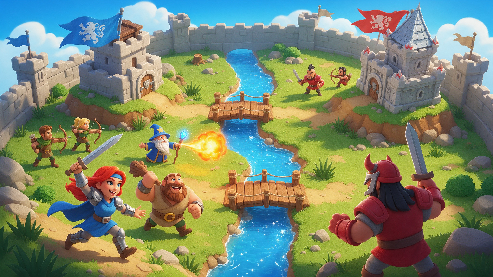

# 3D Royale Clash Arena

Build a card loadout, spend elixir, and deploy a 3D army across the river to take down your AI rival's towers.

A complete single-player lane battler for mobile and desktop: menu, card collection, loadout, matches and rewards.

> **Disclaimer:** This is an original game template in the lane-battler genre. It is not affiliated with, endorsed by, or connected to Clash Royale, Supercell, or any official copyright holder. Please make your own spin on it.

## What's inside

- Drag-and-drop card deployment backed by a regenerating elixir economy.
- Eight cards: Barbarian, Wizard, Giant, Bomber and Builder units, a Cannon building, and Arrows and Freeze spells.
- An enemy card AI with its own elixir, a weighted deck and tactical spell placement.
- Base and princess towers, crown scoring, a match timer and sudden-death bombardment.
- Persistent card unlocks, upgrades, coins and configurable loadouts.
- Touch-first mobile presentation (Mobile renderer) that also runs on desktop.

## Get started

1. [Download the ZIP](https://github.com/SummerEngine/template-3d-royale-clash-type/archive/refs/heads/main.zip) or clone the repo:
   `git clone https://github.com/SummerEngine/template-3d-royale-clash-type.git`
2. Open the folder in [Summer Engine](https://www.summerengine.com/download).
3. Press Play, set your loadout in the menu, and start a match.

Summer's AI agent can extend it for you. Try asking:

- "Add a new card: a flying dragon that breathes fire on ground units."
- "Add a second arena with a lava theme that unlocks after five wins."
- "Make the enemy AI harder: save elixir and counter-push after defending."

## How to play

- Drag a card from your hand onto the arena to deploy it, or tap it to drop it in front of you. Each card costs elixir, which refills over time.
- Units fight enemy units and towers on their own.
- Each princess tower you destroy is a crown. When the 2:00 clock runs out, the most crowns wins. On a tie, sudden death starts and bombs fall until one side takes a tower.
- Open a card in the Army screen to inspect its stats.
- On desktop, use the mouse in place of touch.

## Building on it

- `scripts/card_catalog.gd` is the single source of truth for cards: id, art, elixir cost, model, behavior script, unlock price and level-scaled stats. Add a card there.
- `scripts/battle_manager.gd` owns the match, both elixir economies, deployment, the enemy deck AI, towers, crowns, the timer and sudden death.
- Profile, unlock and loadout state is saved to `user://settings.cfg`.

## License

MIT. See [LICENSE](LICENSE).
